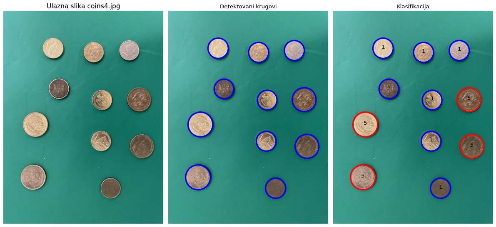
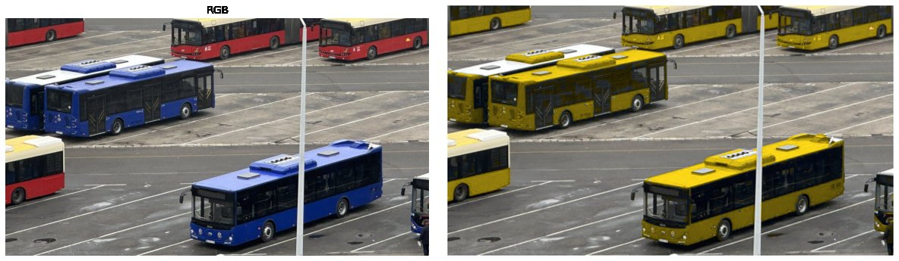
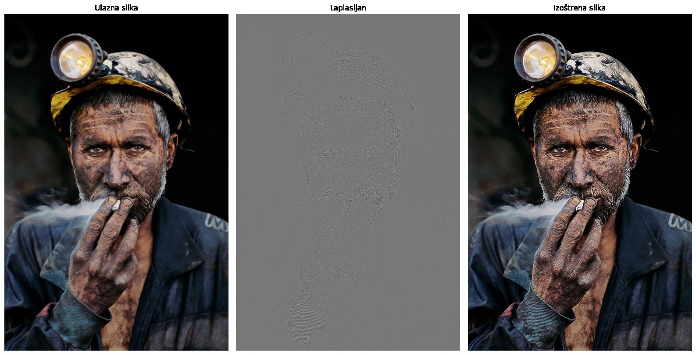
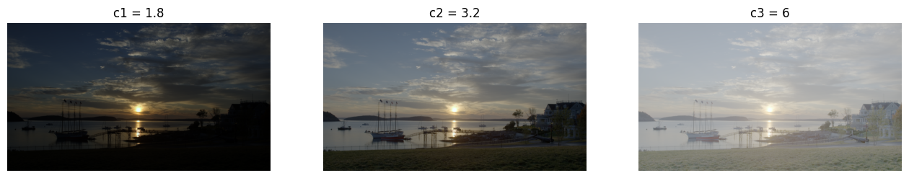
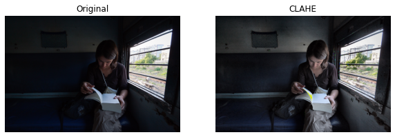
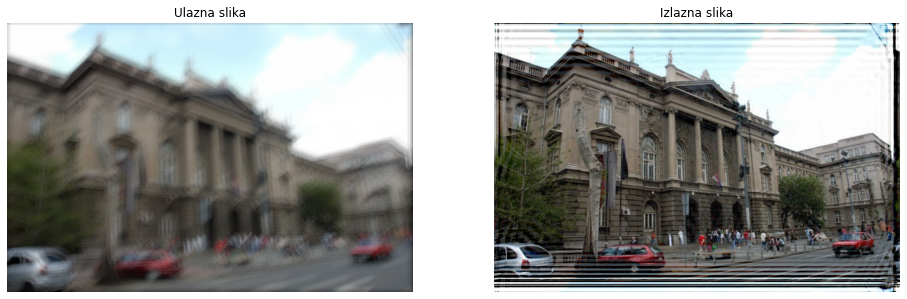
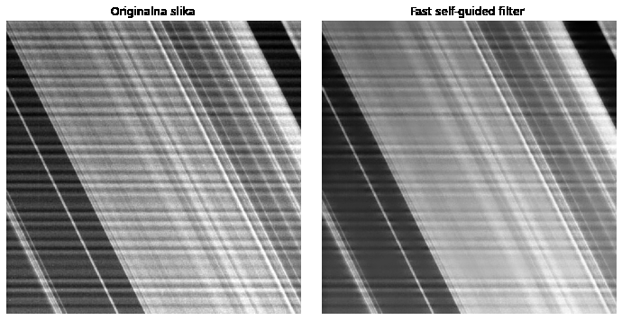
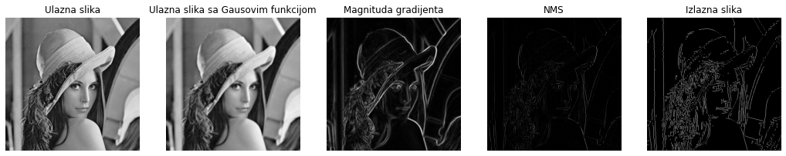

# Digital Image Processing – Python

Three homework assignments from the course *Digital Image Processing* (Digitalna obrada slike), School of Electrical Engineering, University of Belgrade.
They are written in Python (NumPy, SciPy, scikit-image, Matplotlib) as Jupyter notebooks. Several classic algorithms are **implemented from scratch** rather than taken from a library: CLAHE, connected-component labelling, the Canny edge detector and the self-guided filter.

The notebooks are saved with their outputs, so all results can be viewed directly on GitHub.

Coin detection and classification (1 vs 5 dinars): input · detected circles (Hough transform) · classification by radius.

## Contents

| Notebook | Topics |
|---|---|
| [`hw1_color_hdr_sharpening_clahe.ipynb`](notebooks/hw1_color_hdr_sharpening_clahe.ipynb) | color segmentation in HSV · HDR tone mapping (linear, log and power) · Laplacian sharpening in YUV · **CLAHE from scratch** with bilinear interpolation, with run-time comparison against scikit-image |
| [`hw2_fourier_wiener_noise_guided_filter.ipynb`](notebooks/hw2_fourier_wiener_noise_guided_filter.ipynb) | Gaussian filtering in the frequency vs spatial domain (analytical σ relationship, anisotropic filters) · **Wiener deconvolution** of a blurred colour image · **noise variance estimation** from local variance histograms · **self-guided filter** and its fast, subsampled version |
| [`hw3_coin_detection_canny.ipynb`](notebooks/hw3_coin_detection_canny.ipynb) | coin segmentation (HSV and Otsu) · **connected-component labelling from scratch** (8-connectivity) · Hough circle detection and classification by size · **Canny edge detector from scratch** (Gaussian smoothing, Sobel gradients, non-maximum suppression, hysteresis) |

## Selected results

**Color segmentation and recoloring (HSV):** buses of different colours are found with hue/saturation masks and recoloured to a single colour.

**Laplacian sharpening on the luminance channel (YUV):** input · Laplacian · sharpened.

**HDR tone mapping:** logarithmic mapping for different compression factors.

**CLAHE (own implementation):**

**Wiener deconvolution:** known blur kernel, with gamma linearization before filtering.

**Self-guided filter (fast version):** edge-preserving smoothing.

**Canny edge detector (own implementation):** input · Gaussian smoothing · gradient magnitude · non-maximum suppression · hysteresis.

## Notes

- The input images were provided by the course and are not part of this repository. The notebooks expect them in a `sekvence/` folder next to the notebooks.
- Explanations and comments in the notebooks are in Serbian.

## Tools

Python · NumPy · SciPy · scikit-image · Matplotlib · Jupyter
